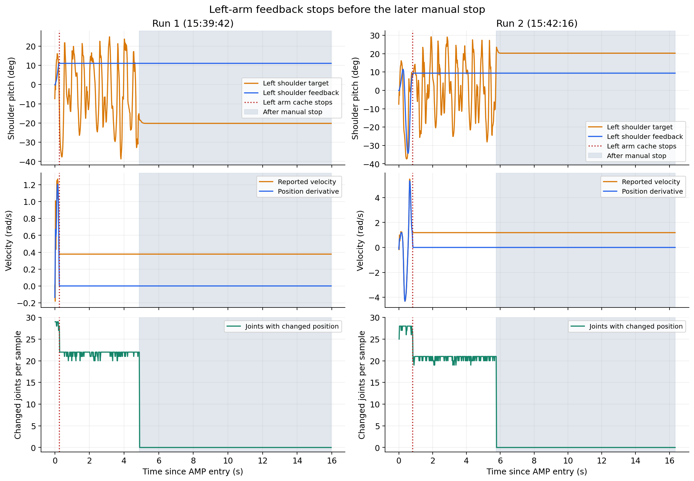
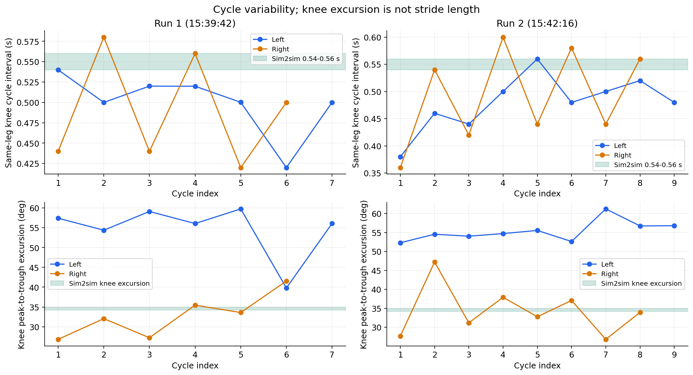
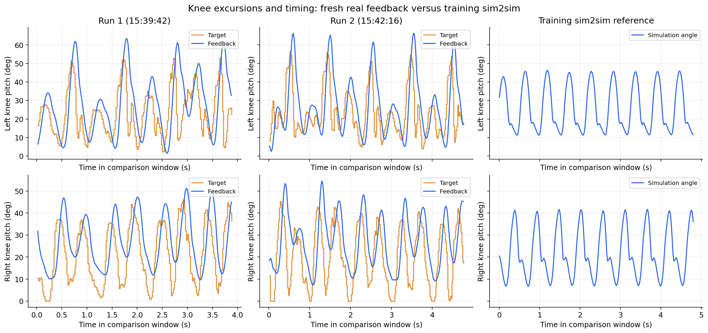
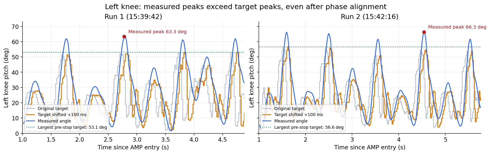
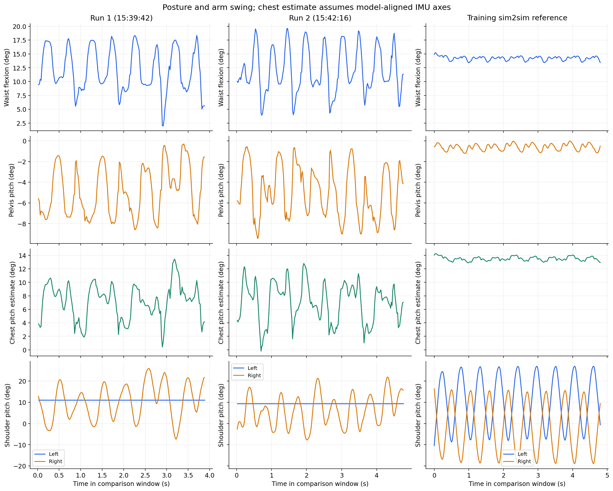

# 2026-10-13 AMP 实机行走与训练 sim2sim 数据对照

两次实机日志都支持“节奏不均匀、两腿运动不对称、胸部前倾不足、摆臂不足”的观察。最明确的异常是：**逻辑左臂 7 个关节的反馈在行走开始后 0.26 s / 0.82 s 就成组停止更新，策略仍在使用这些旧位置、旧速度。** 下肢同时存在较大的目标与实际角度相位差，以及训练 sim2sim 源码没有同样实现的目标限位裁剪。这些现象足以说明当前实机闭环条件与理想仿真不同，但不能仅凭日志认定某一个 PD 参数、机械方向或 CAN 故障就是全部原因。

用户已确认后面人为停止。两次全身反馈停止更新后的尾段均已排除，不能将其当作行走期间的故障。

**数据来源与分析范围**

| 数据 | 内容及采用范围 |
|---|---|
| `/Users/yumx/Downloads/walk_diag_20261013_153942.csv` | 实机第 1 次，799 帧、15.96 s；全身反馈最后变化于 4.8798 s，性能统计采用 1.0–4.8798 s、194 帧 |
| `/Users/yumx/Downloads/walk_diag_20261013_154216.csv` | 实机第 2 次，818 帧、16.34 s；全身反馈最后变化于 5.7598 s，性能统计采用 1.0–5.7598 s、238 帧；此文件从 Downloads 中补充找到 |
| `/Users/yumx/Downloads/ecat_stats_20261013_154343.csv` | 仅 2 行 EtherCAT 汇总，写出时刻 15:43:53 / 15:44:04；不是关节方向测试明细 |
| `/Users/yumx/code/X1_29_AMP/acceptance/v59c_eval/soup59c_50_walk10.npz` | 训练仓库归档 sim2sim，指令 `[1,0,0]`，50 Hz，无记录的观测噪声、观测延迟、动作延迟和推力扰动，未倒地；采用 1.5–11.98 s |
| `/Users/yumx/code/X1_29_AMP/acceptance/v59c_eval/soup59c_50.policy.npz` | 用于离线重放的策略权重及观测归一化参数 |

原始文件只读，未改写、未复制到 Git 仓库。输入 SHA256、逐关节指标和归档 sim2sim 元信息见 [metrics.json](analysis/amp_20261013/metrics.json)，精简指标见 [joint_metrics.csv](analysis/amp_20261013/joint_metrics.csv)。参考 rollout 来自用户确认的训练仓库，但不能证明它就是用户所看视频对应的那一次运行。现场运行的提交号、实际加载的 DCU 配置与固件版本仍需核实。

**1. 模型、观测排列和策略时钟**

两次日志全程指令都是 `[1,0,0]`。采样周期均值约 20.000 ms，标准差分别 0.061 / 0.058 ms，最大分别 20.378 / 20.218 ms。记录的策略循环没有出现能解释长短步变化的明显丢周期。

使用日志中的 IMU、29 关节位置/速度、前一帧 action，按当前部署契约重建 96 维 × 3 帧的 term-major 观测，再经过训练归一化器和 `soup59c_50` 网络：

| action 数值误差 | 第 1 次 | 第 2 次 |
|---|---:|---:|
| 平均绝对误差 | 1.63×10⁻⁶ | 1.60×10⁻⁶ |
| 最大绝对误差 | 3.81×10⁻⁵ | 1.18×10⁻⁵ |

这强力支持当前日志使用的模型数值、观测历史、归一化、策略关节排列与 `soup59c_50` 一致。它不验证物理接线、机械零位、固件或电机实际收到的参数，也不代表实测机器人已经达到 1 m/s；日志记录的是速度指令，没有真实线速度/里程计。

当前配置的下肢名义 PD 与训练 sim2sim 的 `PD_GAINS` 一致：hip pitch `120/4`，hip roll/yaw `100/3.3`，knee `150/5`，ankle pitch/roll `50/2.5`。部署策略 50 Hz，位置与踝力矩 LPF 均关闭。**策略目标的更新频率与底层 PD/力矩计算频率是两个不同层次**：部署踝关节为并联机构的软件 PD → 力矩映射，髋膝使用电机侧控制；训练 harness 支持显式 PD 及原生位置伺服两条路径。归档元信息没有完整记录底层伺服模式，不能据此宣布底层执行器等价。配置见 [rl_x1.yaml](../motion_control/module/control_module/cfg/rl_x1.yaml)。

**2. 最高优先级：左臂反馈成组冻结**

| 证据 | 第 1 次 | 第 2 次 |
|---|---:|---:|
| 左臂 7 关节反馈最后变化 | 0.2598 s | 0.8198 s |
| 冻结的左肩 pitch 位置 | 0.192421 rad | 0.163659 rad |
| 同时重复的左肩 pitch 速度 | +0.377452 rad/s | +1.187590 rad/s |
| 同时重复的左肩 pitch effort | −2.515260 | −3.687420 |
| 左肩 pitch 目标摆幅（P95−P5） | 49.77° | 48.09° |

肩、肘、腕全部 7 关节的 21 个 position/velocity/effort 字段从这些时刻起逐帧完全相同，其他关节与 IMU 仍在变化。恒定位置配合恒定非零速度尤其说明这不是正常静止的测量结果。策略输出仍在变化，不能解释为没有生成摆臂指令。

冻结位置不能用于推断真实左臂摆幅，也不能区分“电机没有运动”和“电机运动但反馈丢失”。当前 CSV 没有上肢原生执行器命令、CAN 收包计数或反馈年龄，无法将问题进一步锁定到 CAN 物理支路、DCU 转发、SDK 收包缓存或发布链路中的某一级。

仓库默认 [dcu_x1.yaml](../motion_control/module/dcu_driver_module/cfg/dcu_x1.yaml) 将逻辑左臂 7 电机放在 `body / ecat_id=1 / channel_1 / CAN ID 1–7`，右臂在 `channel_2`，腰 roll/pitch 在 `channel_3`。如果现场配置相同，应优先查 channel_1 支路、供电/线缆、DCU CAN 转发及 SDK 接收更新。该 body 节点的另外两条支路仍有动态数据，单独的左臂支路问题比整条 EtherCAT 同时中断更符合日志。

此前人工描述“右臂不动”，本次行走日志明确停更的是**逻辑左臂**。需通过单关节命令核实机器人自身左右、配置命名和实际接线；不能直接调换左右或翻转 direction。本次没有独立的 `upper_direction` 测试 CSV/JSON，重复提供的 EtherCAT 文件无法代替该数据。



还发现一处新鲜度检查的局限：DCU 周期读取 SDK 的缓存，重新生成消息时间戳并发布；ControllerBase 每次接收消息就刷新 `last_joint_state_ns_`，AmpReady 检查的是消息接收年龄。因此某条 CAN 支路缓存不更新时，整条 JointState 消息仍然“新鲜”。后面的人工停止尾段也显示日志和动作还在继续刷新而物理反馈已不更新。**消息活跃不能替代逐执行器反馈活跃**。可靠检查应基于实际收包序号/时间，而不是简单要求 position 每帧变化；静止关节也必须允许有效的新反馈。

代码位置：[DCU 发布链路](../motion_control/module/dcu_driver_module/src/dcu_driver_module.cc)、[反馈接收时间](../motion_control/module/control_module/src/controller_base.cc)、[AmpReady](../motion_control/module/control_module/src/rl_controller.cc)。

**3. 下肢：长短周期、左右不对称与表观相位滞后**

为避免凭视频印象量化，采用同一侧 knee pitch 峰之间的间隔。峰检测为 3 帧离线平滑、最小峰间隔 0.3 s、prominence 0.12 rad。它反映关节周期，**不是接触检测所得步时，也不是实际米制步长**。实机每侧仅有 6–9 个完整间隔，且分辨率为 20 ms。

| 同侧膝关节周期 | 训练 sim2sim | 实机第 1 次 | 实机第 2 次 |
|---|---:|---:|---:|
| 左侧周期范围 | 0.54–0.56 s | 0.42–0.54 s | 0.38–0.56 s |
| 右侧周期范围 | 0.54–0.56 s | 0.42–0.58 s | 0.36–0.60 s |
| 左侧周期变异系数（std/mean） | 1.64% | 7.09% | 10.01% |
| 右侧周期变异系数 | 1.73% | 12.64% | 16.73% |
| 左膝单周期角度峰谷差 | 约 34.5° | 39.8–59.8° | 52.3–61.2° |
| 右膝单周期角度峰谷差 | 约 34.5° | 26.8–41.6° | 26.8–47.2° |

整体角度摆幅用 P95−P5 统计：左膝实机 54.67° / 55.17°，仿真 33.79°；右膝实机 35.75° / 37.82°，仿真 33.44°。左髋 pitch 实机 70.34° / 72.36°，仿真 39.43°。因此实机不是简单“所有关节都摆得小”，而是左腿过大的运动、左右差异和周期变化同时存在。

策略膝目标本身也有长短周期：右侧目标周期变异系数约 16.3% / 18.3%。异常已经出现在闭环策略输出，不只是电机执行固定动作时计时不准。策略会依赖全身反馈改变运动；左臂旧位置/旧速度、实际姿态、接触和执行器响应都可能影响输出。左臂停更是明确异常，但其对腿部节奏的因果贡献仍需修复后的对照实验确认。



| 目标与实测角度 | 第 1 次 MAE | 第 2 次 MAE | 相关性最佳的正向时移 |
|---|---:|---:|---:|
| 左 hip pitch | 23.13° | 22.07° | 约 120 ms |
| 右 hip pitch | 12.74° | 14.20° | 约 120 ms |
| 左 knee pitch | 14.61° | 13.44° | 约 100 ms |
| 右 knee pitch | 13.02° | 13.79° | 约 80 / 100 ms |

相关性比较是在 0–140 ms 内平移目标序列得到的诊断量；平移后髋膝 MAE 约降至 5.6–7.4°。**80–120 ms 是周期运动的表观相位差，不是测得的 CAN 或 EtherCAT 通信延迟。** 惯性、接触载荷、固件滤波、控制模式、有效增益和力矩限制均可能产生这种表现。不能直接从它得出“kd 太大”或“kp 太小”，也不能用周期信号拟合的力矩系数替代真实固件增益解码。

髋 pitch / 膝的日志速度与位置差分高度一致：相关系数大于约 0.996，斜率约 0.97–0.98，暂未见这几项速度存在明显单位或符号错误。它不验证关节的机械零位，也不排除其他关节、执行器模式或力矩标定的问题。



**左膝摆幅 55°：策略要求还是实际响应放大？**

实机左膝目标摆幅约 43°，实际约 55°，明确存在实际运动超过目标幅度的现象。此处所有摆幅均为同一性能窗口的 P95−P5，而不是绝对峰值角度。

| 同窗口摆幅/范围对照 | 第 1 次 | 第 2 次 |
|---|---:|---:|
| 左膝目标摆幅 | 42.99° | 43.00° |
| 左膝实际摆幅 | 54.67° | 55.17° |
| 实际/目标摆幅比 | 1.272 | 1.283 |
| 左膝目标 P5–P95 | 5.69–48.68° | 8.02–51.02° |
| 左膝实际 P5–P95 | 5.45–60.12° | 6.20–61.37° |
| 右膝目标摆幅 | 39.98° | 40.23° |
| 右膝实际摆幅 | 35.75° | 37.82° |

左膝的高角度端比目标高约 10–11°，低角度端比较接近目标，因此主要是屈膝峰值超过要求。左右目标摆幅仅差约 3°，左右实际摆幅却差约 17–19°，说明大的左右差异不能只归因于策略要求。

这不是纯相位滞后造成的比较错觉：停止前全段记录到的左膝最大目标分别只有 53.15° / 56.57°，最大实际角度却为 63.28° / 66.32°，实际超过本段任何目标约 10.13° / 9.75°。目标整体后移约 100 ms 后，实际峰值仍明显更大。摆幅比只是轨迹统计量，不等于电机固定的传递增益。

以第 2 次 4.46–4.54 s 为例：目标由约 54.5° 降到 35.6°，实际左膝继续由 45.0° 增至 66.3°；到 4.50 s，实际已到 59.3°，目标为 51.1°，实际速度仍为 +5.19 rad/s，反馈关节力矩已为负、按当前关节符号处于抵抗继续屈膝的方向。此段符合目标下降时关节仍因已有速度/耦合载荷继续屈膝的动态超调表现。单凭它不能确认是有效阻尼不足、制动力矩限制、执行器内部延迟/滤波还是髋部及接触外力所致，更不能仅凭名义 `kp=150, kd=5` 判定阻尼比。

训练归档 rollout 只保存实际 q/dq，没有目标/action 和完整 base 角速度，不能精确重建其策略输入并给出可验证的仿真目标摆幅。因此 **33.79° 是仿真实际摆幅，不能直接拿它与实机目标 43° 相减，宣称策略比仿真多要求了 9.2°**。当前可确定的是“实机要求约 43°，实际运动又增至约 55°”；策略目标相对仿真究竟增大多少，需要同时记录仿真目标再对照。

下一步应优先检查左膝屈曲速度大时的有效制动响应，核实电机实际接收的目标、kp/kd、原生角速度和力矩限制，再与右膝及仿真同相位数据比较。当前不直接修改增益或限制 action 来掩盖峰值。



将统计起点从 1 s 改为 2 s 后，右侧周期变异系数仍约 11.4% / 14.7%，胸部估计前倾仍约 7.1° / 7.2°，主要结论不是仅由最初起步过程造成。

**4. 踝关节目标限位与仿真不同**

部署将位置目标裁剪到关节范围；当前训练 sim2sim 的 `q_tgt_full = default + 0.25 * action` 路径没有同样的目标位置裁剪，而是在 PD 后限制力矩。仿真模型自身的机械关节限位与“先裁剪 PD 目标”是不同操作。

| ankle pitch 原始目标被部署裁剪的帧比例 | 第 1 次 | 第 2 次 |
|---|---:|---:|
| 左侧 | 28.35% | 32.35% |
| 右侧 | 45.88% | 48.74% |

当前 pitch 目标限位为 `[-0.41, +0.35] rad`。剪裁改变了接触阶段的期望位置及力矩，属于明确的闭环差异，但裁剪较多本身不证明它是唯一根因。需要先在仿真复现相同限位、并联踝力矩映射与伺服语义，再比较效果；不能直接在真机放宽范围来追求视频效果。

CSV 中踝关节 `pos_des_lpf` 未记录有效值。本分析通过 `q_target = q + (tau_des_raw + kd*dq)/kp` 重建软件 PD 使用的目标，假定当前名义 `kp=50, kd=2.5`，再与原始目标按配置裁剪后的值交叉核对；最大差异仅约 1.7×10⁻⁶ rad。表中裁剪比例与踝跟踪指标使用重建后的目标。

记录到的四个踝电机命令力矩最大绝对值分别不超过 18.51 / 20.30 Nm，没有超过 ±50 Nm MIT 前馈编码范围的帧。这两份 50 Hz 日志没有支持“踝电机前馈编码饱和是主要原因”的证据，但不能排除未被 50 Hz 采样捕获的瞬时峰值或固件内部限制。也不能把 MIT 前馈编码范围当作原生 PD 电机总力矩上限。

**5. 胸前倾不足：腰角略小且骨盆更后仰**

以标准 ZYX pitch 计算 base 姿态，并按训练模型的解剖轴约定组合腰 yaw/roll/pitch：`R_chest = R_base · Rz(q_yaw) · Rx(-q_roll) · Ry(q_pitch)`，得到胸部姿态估计。这不是独立胸部 IMU 测量；**必须以实际 IMU 安装轴、姿态校准和腰角零位符合模型为前提**。

后续结合 main 已真机走通的基线，确认 main 与 AMP 的 IMU 发布映射一致、根坐标定义一致，重力向量计算逐帧差异小于 2×10⁻⁷。因此，在安装与固件未变的前提下，大幅轴向/符号错误应降低优先级；保留这一校准条件并不意味着已有证据说明 IMU 安装错误。完整对照见 [main 的 IMU 证据](amp_imu_main_comparison.zh_CN.md)。

| 平均角度 | 训练 sim2sim | 实机第 1 次 | 实机第 2 次 |
|---|---:|---:|---:|
| 腰 pitch 屈曲 | +14.20° | +12.13° | +12.06° |
| base / 骨盆 pitch | −0.58° | −4.89° | −4.88° |
| 胸部 pitch 模型估计 | +13.51° | +7.16° | +7.06° |
| 腰 pitch 摆幅（P95−P5） | 1.06° | 11.54° | 12.98° |

按此坐标前提，前倾不足约 6.4°，其中约 2° 来自腰角较小，约 4.3° 来自骨盆更后仰。实机腰角还在大幅周期变化，而仿真腰角很稳定。腰目标平均 12.22° / 11.84°，跟踪 MAE 2.14° / 2.25°；性能窗口内腰目标裁剪比例为 0，旧的 `+0.15 rad` 上限问题未在这两次稳态窗口重现。

因此继续增加腰零位不能解决全部姿态差异。应先核实 IMU 轴及静态姿态，再在反馈健康的闭环里处理骨盆姿态、腿部响应和接触差异。

**6. 摆臂与腕关节**

仿真左右肩 pitch 摆幅（P95−P5）约 34.01° / 33.52°，左右反相相关性约 −0.998。实机左肩反馈已冻结，其实际摆幅无法从本数据测量；但左肩目标摆幅 49.77° / 48.09°，不是目标太小。

实机右肩 pitch 反馈摆幅 25.72° / 22.44°，目标摆幅 30.16° / 28.10°，表观相位差约 100 ms，零时移 MAE 约 8.6°。右侧存在目标和实际摆幅都小于理想仿真的现象。右肩 roll 的侧向摆动反而明显大于仿真，因此不能把上肢所有方向的动作都统一放大。

右腕也值得复查：第 1 次右腕 pitch/roll 目标与反馈相差约 40°且反馈摆幅很小；第 2 次右腕 pitch 的位置在整个运动窗口为 0，而目标仍变化。不能据此直接翻转腕 direction，应结合原生电机目标、反馈、L28 模式及机械零位判断。L28 位置通路并不使用上层发来的 kp/kd，单改腕部 PD 未必改变实际响应。



**7. 零转向指令下有较大的航向变化**

从 AMP 切入到人工停止前，IMU 四元数解算的航向变化为 −69.97° / −74.24°；body gyro_z 积分约 −67.25° / −73.67°，而 yaw 指令恒为 0。两种信号一致，不能仅用姿态融合的航向跳变解释。

这提示明显的偏航运动/不对称或外部干预，需要结合录像、保护支撑及 IMU 安装确认。gyro_z 是 body 轴角速度，积分也不是严格的世界 yaw；这里仅用于一致性检查。不能凭它独立认定机器人在地面准确转了上述角度。该现象和左右腿、左右臂的不对称值得放在一起排查。

**8. EtherCAT 数据能说明什么**

| 汇总写出时刻 | 平均调度迟到 | 最大调度迟到 | overrun / cycle | WKC 异常轮询 |
|---|---:|---:|---:|---:|
| 15:43:53 | 0.120 ms | 1.687 ms | 18 / 10021，约 0.18% | 0 |
| 15:44:04 | 68.350 ms | 2862.862 ms | 354 / 7880，约 4.49% | 10 |

第二段确有很大的调度迟到，应结合当时是否停机、恢复链路或退出程序排查。但是文件创建于约 15:43:43，晚于两次行走有效窗口，不能用它直接解释 15:39 / 15:42 的步伐问题，也不能判断某个上肢关节是否收到测试命令。`wkc_bad_polls=10` 是每 100 ms 错误处理线程的异常轮询计数，不是“丢了 10 个 1 kHz 帧”。overrun 的代码定义是迟到超过名义周期的 20%，并不等同于整周期超时。

统计源码另有两个确定的数值问题：

- `st_dc_dev_abs_min_ns_` 初始化及每次清零为 `INT64_MIN`，但更新条件要求绝对偏差小于该值，因此 minimum 永远不会被正常的非负样本更新。两行的 `−9223372036854775808` 不是真实测量。
- `last_dc_time=0`，首轮将绝对 DC 时钟减去 0，当成一周期 DC 增量。第一行巨大的 DC 平均值/最大值受该首样本污染，不能解读成真实同步抖动。

代码见 [ethercat_manager.cpp](../motion_control/module/dcu_driver_module/xyber_controller/xyber_api/src/ethercat_manager.cpp) 及 [ethercat_manager.h](../motion_control/module/dcu_driver_module/xyber_controller/xyber_api/include/internal/ethercat_manager.h)。本次分析只标记这些字段，不把它们用作行走故障证据。

**建议处理顺序**

1. **先恢复全部 29 关节的有效反馈。** 确认现场 `motion_control` 提交及加载配置；先用已有静态测试核对左右命名，优先检查左臂 CAN1。同步保存 joint command/state、actuator command/state 和支路接收计数/反馈时间。区分“原生指令未变化”“原生指令变化但电机未动”“电机动但 SDK 数据停更”。读诊断命令及流程见 [上肢静态方向测试](上肢静态方向测试.md) 和 [链路审查](upper_direction_link_audit.zh_CN.md)。
2. **确认 IMU 与零位。** 在支撑下比较直立、人工前倾、后仰时的 IMU pitch 符号，并核对腰反馈；同时确认日志的航向变化是否为真实偏航、扶持或坐标问题。
3. **在仿真复现部署限制与执行器链路。** 加入相同目标裁剪，核实髋膝固件控制模式及增益编码、内部滤波/力矩限制、踝软件 PD 频率和并联力矩映射。可做 A/B：理想全身反馈 → 复现实机左臂旧反馈 → 部署执行器/限位，以分离影响。先补齐模型条件，避免同时改频率、增益、零位和限位而无法归因。
4. **反馈恢复后，再判断是否调整下肢 kp/kd。** 名义训练与部署一致不保证真实执行器等价。先测髋膝幅频响应/原生反馈及力矩限制；观察 80–120 ms 表观相位差和左右不对称是否仍存在。不能据这两份短日志直接定一组新参数保证 1 m/s 稳定。
5. **做同条件复测。** 反馈健康、可靠支撑下从已验证的 0.6 m/s 逐步到 1 m/s，每次保留停止前完整数据和同一进程对应的 EtherCAT 统计；使用里程计/外部测量记录实际速度与足端接触/步长，再与相同限位和伺服条件的 sim2sim 比较。

**复现与验证**

本次新增分析脚本、指标与图表；控制参数及机械方向未在本次分析中修改。分析脚本要求 Python 3、NumPy、pandas、PyYAML；周期统计需要 SciPy，绘图需要 Matplotlib。若无 PyYAML，脚本保留 Ruby YAML 回退。

在 F1 根目录运行（修改为服务器上的实际日志和训练仓库路径）：

```bash
python3 scripts/analyze_amp_walk_logs.py \
  /path/to/walk_diag_20261013_153942.csv \
  /path/to/walk_diag_20261013_154216.csv \
  --policy /path/to/X1_29_AMP/acceptance/v59c_eval/soup59c_50.policy.npz \
  --sim /path/to/X1_29_AMP/acceptance/v59c_eval/soup59c_50_walk10.npz \
  --ecat /path/to/ecat_stats_20261013_154343.csv \
  --out /tmp/amp_walk_analysis

python3 scripts/plot_amp_walk_analysis.py \
  /tmp/amp_walk_analysis/metrics.json \
  --out /tmp/amp_walk_analysis/plots
```

`--steady-start 2` 可复核排除前两秒后的结果。报告所述人工停止判断来自用户确认；脚本自动窗口只根据全身反馈最后变化确定，处理其他数据时需人工确认该窗口的含义。重建踝目标依赖运行时 PD/限位与输入 `--config` 一致；不要使用事后改过的配置解读旧日志。图中的冻结左臂曲线表示日志中的旧反馈，不能当作实际运动轨迹。

已完成两份日志的数值重放、踝目标交叉核对、1 s/2 s 起点敏感性检查、左膝峰值及相位对照、脚本语法检查及五张图的视觉检查。未进行新的机器人控制、服务器运行或真机验证。
